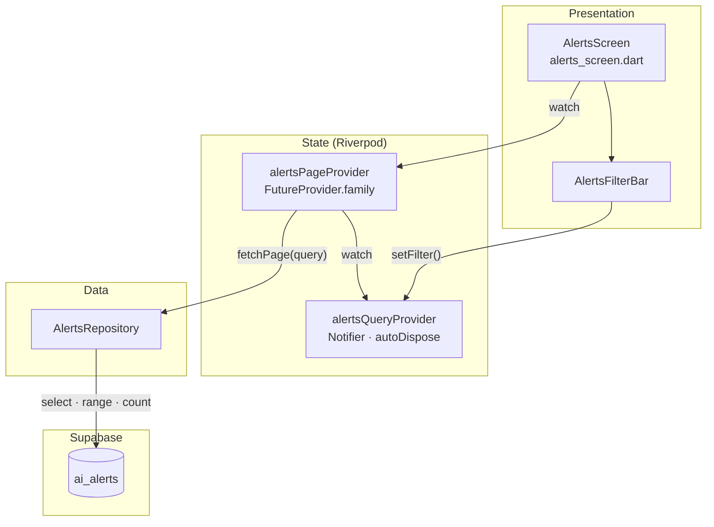
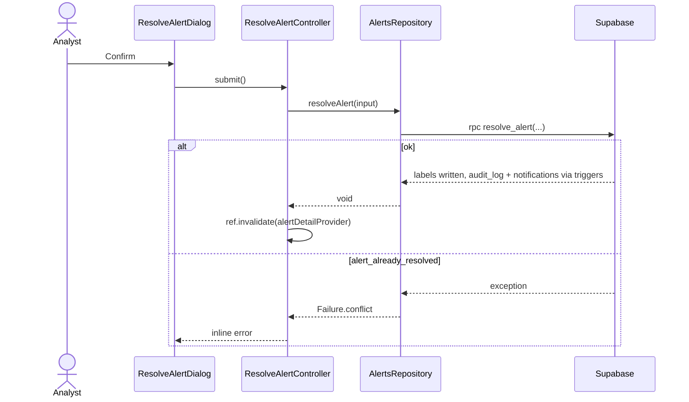
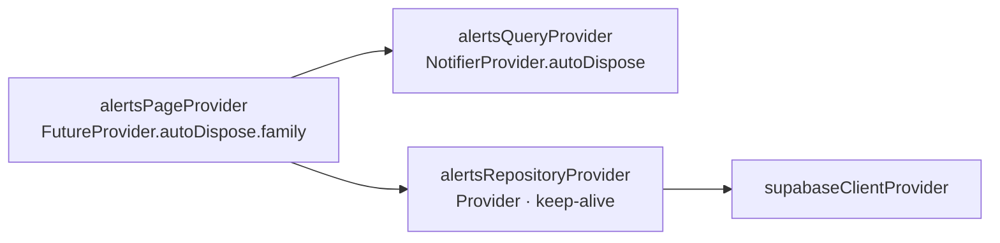
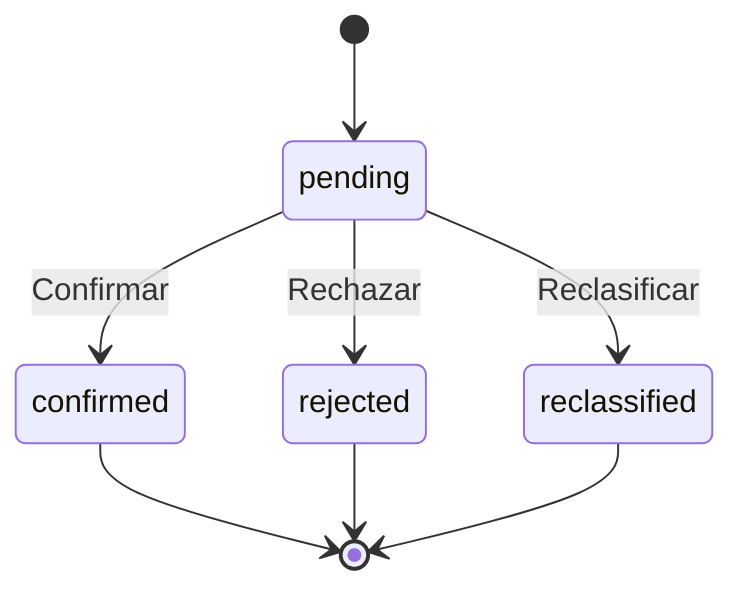

# Diagrams

Use Mermaid in fenced ```mermaid blocks. They render on GitHub and in Markdown previews with
Mermaid support, and they stay readable as text. Every node is something real that you read: a
file, provider, class, view, RPC or table. No invented boxes.

## Which diagrams to draw

| Diagram | Draw it when | Required? |
| --- | --- | --- |
| Layer map (`flowchart`) | always | yes |
| Sequence (`sequenceDiagram`) | for each main user flow: load, filter, save, resolve… | yes, one per main flow |
| Provider graph (`flowchart`) | the target has 3 or more providers | when applicable |
| State (`stateDiagram-v2`) | there is a lifecycle: alert status, save status, form steps, connection status | when applicable |
| Class (`classDiagram`) | the domain has 3 or more related models or a sealed hierarchy | when applicable |
| ER (`erDiagram`) | the target reads or writes 2 or more tables | when applicable |
| Widget tree (`flowchart TD`) | a screen or a large widget | when applicable |

Keep each diagram under about 25 nodes. If it grows, split it by layer or by flow. Put a sentence
before each diagram saying what to look at.

The examples below show the shape of each diagram. Their names come from the alerts feature
but are simplified. Do not copy them: rebuild every node from the code you read. In particular,
check whether a write goes through an RPC or through `LocalWritesStore`.

## Layer map

One subgraph per layer, top to bottom. Label the edges with the call or the data that flows.



## Sequence for a flow

Start at the user, end at the re-render. Show the database's work (RPC, triggers), the failure
branch with `alt`, and invalidation or realtime refreshes.



## Provider graph

Edges point from the watcher to the provider it watches. Mark the kind and the lifetime.



## State



## Class and ER

- `classDiagram`: freezed models with their main fields, sealed hierarchies with `<|--`, and
  composition with `*--`. Include enums from `core/domain` when they matter.
- `erDiagram`: only the tables the target touches, with PK and FK columns and the cardinality
  from `docs/mer.puml`.

## Syntax pitfalls

- Quote labels that contain spaces, parentheses, slashes, dots or `:`: `A["fetchPage(query)"]`.
- Use `<br/>` for line breaks inside labels, never `\n`.
- Never use `end` as a node id, and avoid ids that start with `o` or `x` right after `--`.
- Edge labels with special characters go in quotes: `-- "select · range" -->`.
- In `sequenceDiagram`, avoid `;` and `#` in messages.
- `stateDiagram-v2` state names cannot contain spaces. Use ids with labels if needed.
